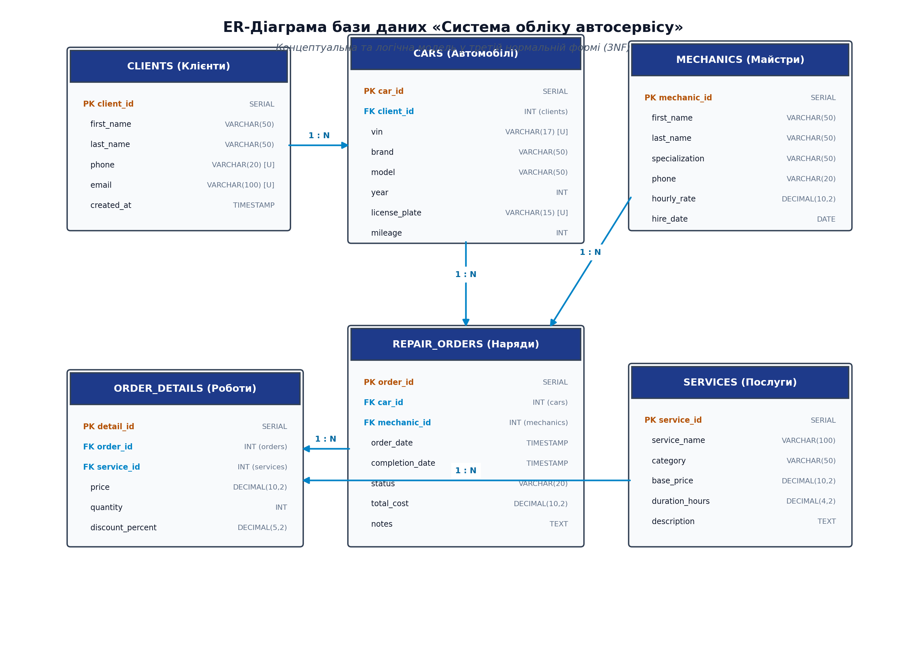
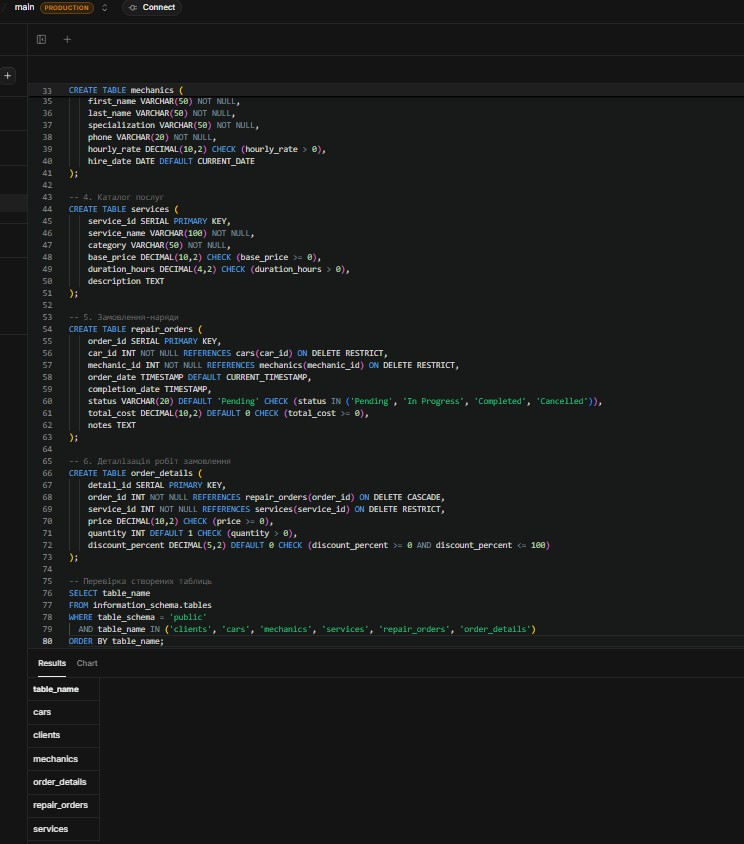
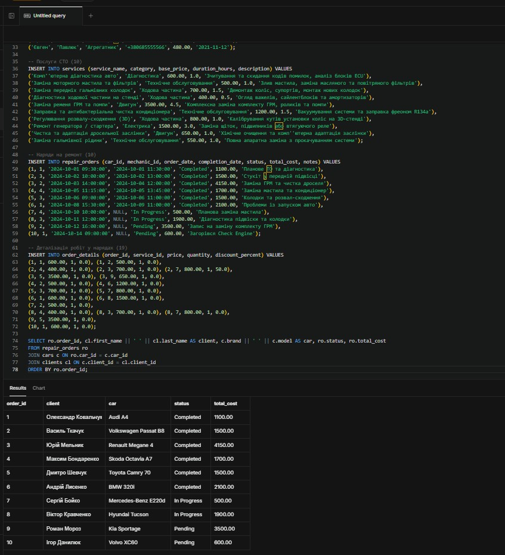
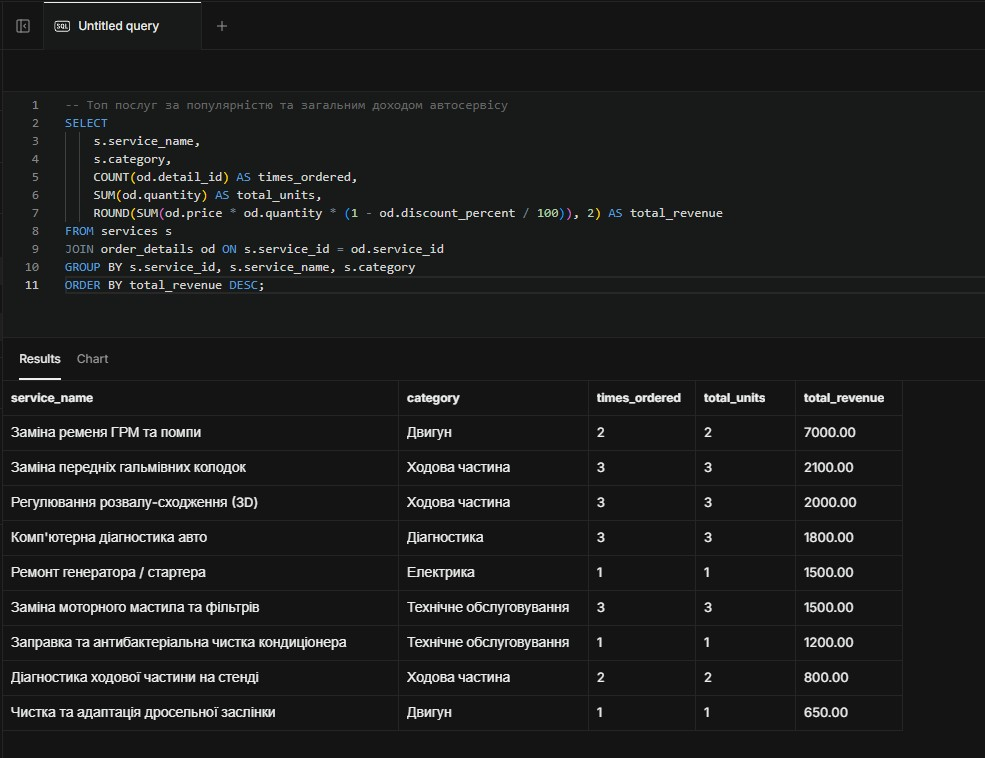
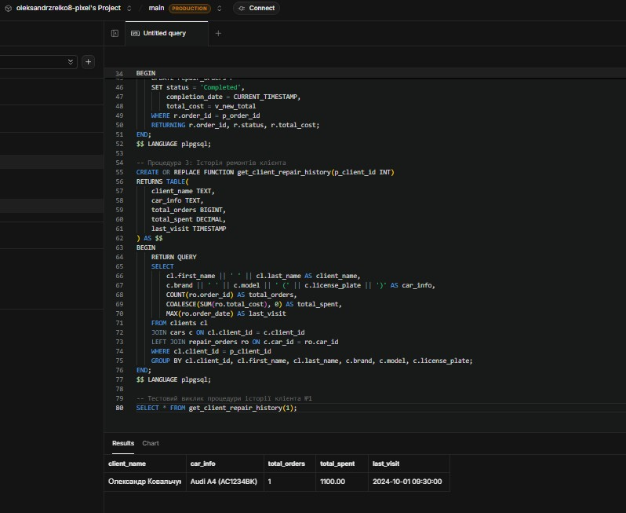
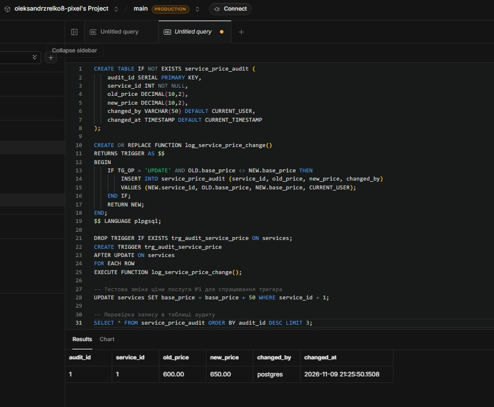
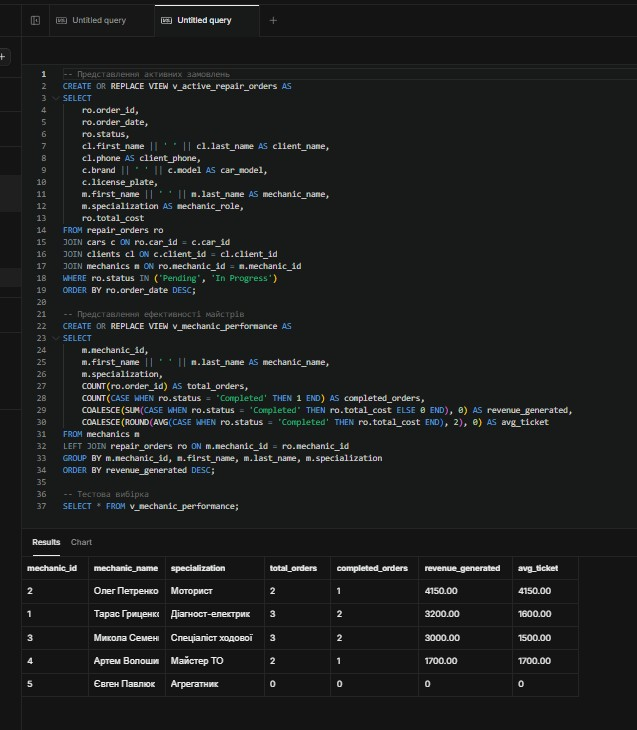
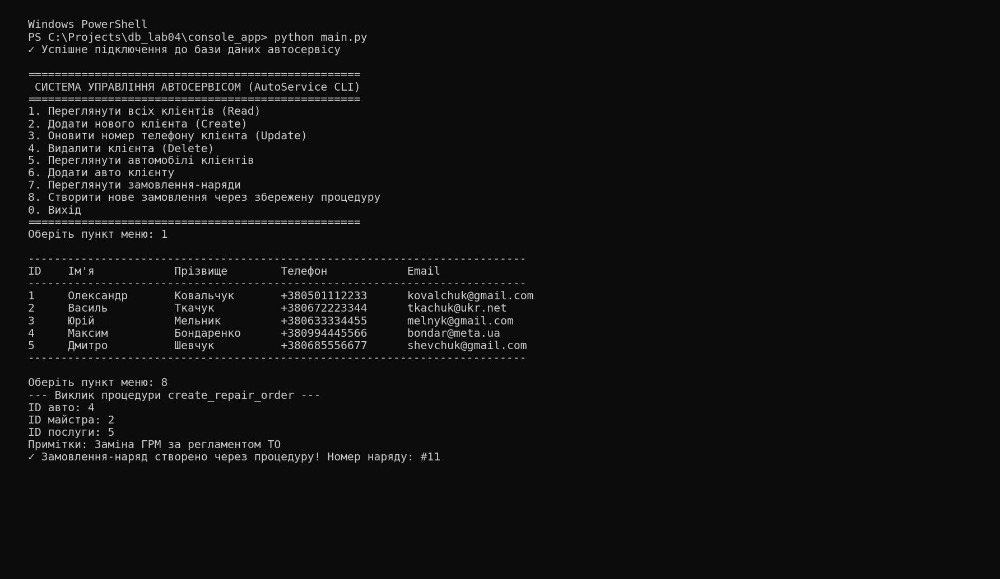
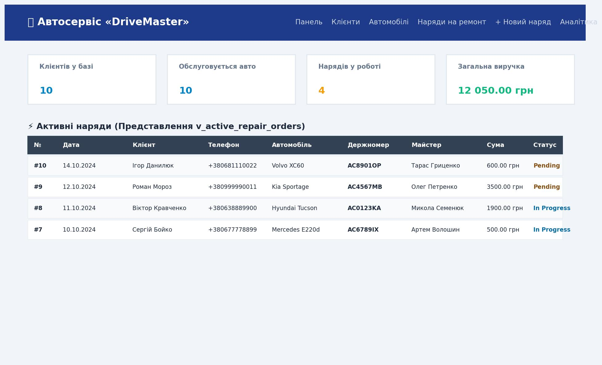
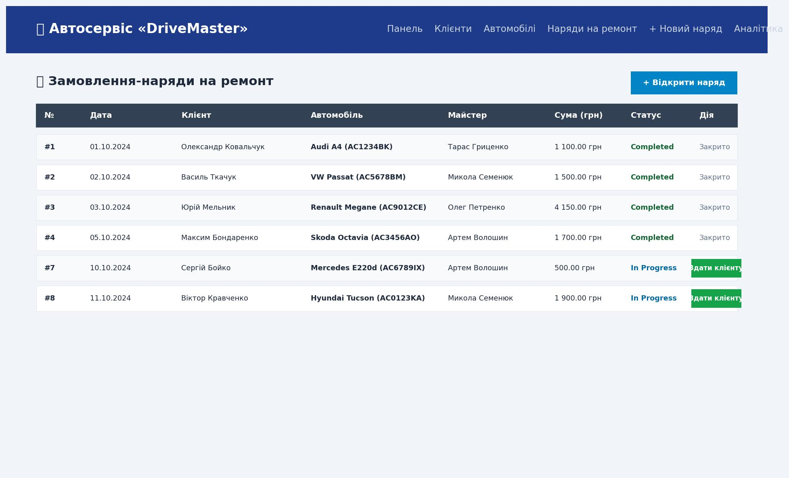

# Звіт з лабораторної роботи №4. Розробка реляційної бази даних з простою інтеграцією

## Загальна інформація

- **ПІБ студента:** Зрелко Олександр Вадимович
- **Група:** ІПЗ - 32
- **Варіант (предметна область):** Система обліку автосервісу («AutoService / DriveMaster»)
- **Рівень виконання:** 2 (Достатній рівень — "добре")

---

## 1. Опис предметної області

Обрана предметна область — **автоматизація операційного обліку станції технічного обслуговування (СТО / автосервісу)**.

### Основні бізнес-процеси автосервісу:
1. **Облік клієнтів та їхніх транспортних засобів:** реєстрація контактних даних автовласників та закріплення за ними одного або кількох автомобілів з фіксацією VIN-коду, марки, моделі, року випуску та поточного пробігу.
2. **Формування та керування замовленнями-нарядами (`repair_orders`):** прийом авто на ремонт, фіксація скарг клієнта, призначення відповідального майстра-виконавця, відстеження життєвого циклу замовлення (`Pending` ➔ `In Progress` ➔ `Completed` / `Cancelled`).
3. **Облік виконаних робіт і використаних послуг (`order_details`):** деталізація кожного наряду з переліком наданих послуг із каталогу, розрахунок вартості, кількості норма-годин та застосування персональних знижок.
4. **Управління персоналом та навантаженням майстрів:** аналіз спеціалізації (моторист, електрик, ходовик), розрахунок погодинної оплати та оцінка ефективності роботи працівників.

---

## 2. Концептуальна модель (ER-діаграма)

У системі виділено 6 ключових взаємопов'язаних сутностей:
1. **`clients` (Клієнти)** — автовласники, які користуються послугами СТО.
2. **`cars` (Автомобілі)** — транспортні засоби клієнтів (зв'язок «один-до-багатьох» з клієнтами).
3. **`mechanics` (Майстри)** — штат працівників автосервісу з різними спеціалізаціями.
4. **`services` (Каталог послуг)** — фіксований прейскурант робіт із базовими цінами.
5. **`repair_orders` (Замовлення-наряди)** — документи обліку конкретного ремонту.
6. **`order_details` (Позиції робіт)** — проміжна таблиця, що реалізує зв'язок «багато-до-багатьох» між нарядами та послугами з каталогу.

_ER-діаграма структури бази даних:_


---

## 3. Логічна схема та нормалізація (3NF)

База даних спроєктована у **третій нормальній формі (3NF)**:
- **1NF (Перша нормальна форма):** усі поля містять виключно атомарні значення (немає масивів чи списків телефонів/послуг в одному полі), кожен рядок має суворий первинний ключ `SERIAL PRIMARY KEY`.
- **2NF (Друга нормальна форма):** таблиця перебуває в 1NF, і всі неключові атрибути повністю функціонально залежать від усього первинного ключа (відсутні часткові залежності від частини складеного ключа).
- **3NF (Третя нормальна форма):** усунуто транзитивні залежності між неключовими полями. Наприклад, у замовленні-наряді не дублюється прізвище клієнта чи марка авто — зберігається лише зовнішній ключ `car_id`, через який база зв'язується з авто, а через авто — з клієнтом.

---

## 4. Реалізація бази даних у PostgreSQL

### Створення структури таблиць

```sql
-- Таблиця клієнтів
CREATE TABLE clients (
    client_id SERIAL PRIMARY KEY,
    first_name VARCHAR(50) NOT NULL,
    last_name VARCHAR(50) NOT NULL,
    phone VARCHAR(20) UNIQUE NOT NULL,
    email VARCHAR(100) UNIQUE,
    created_at TIMESTAMP DEFAULT CURRENT_TIMESTAMP
);

-- Таблиця автомобілів
CREATE TABLE cars (
    car_id SERIAL PRIMARY KEY,
    client_id INT NOT NULL REFERENCES clients(client_id) ON DELETE CASCADE,
    vin VARCHAR(17) UNIQUE NOT NULL,
    brand VARCHAR(50) NOT NULL,
    model VARCHAR(50) NOT NULL,
    year INT CHECK (year >= 1980 AND year <= EXTRACT(YEAR FROM CURRENT_DATE)),
    license_plate VARCHAR(15) UNIQUE NOT NULL,
    mileage INT CHECK (mileage >= 0),
    created_at TIMESTAMP DEFAULT CURRENT_TIMESTAMP
);

-- Таблиця майстрів
CREATE TABLE mechanics (
    mechanic_id SERIAL PRIMARY KEY,
    first_name VARCHAR(50) NOT NULL,
    last_name VARCHAR(50) NOT NULL,
    specialization VARCHAR(50) NOT NULL,
    phone VARCHAR(20) NOT NULL,
    hourly_rate DECIMAL(10,2) CHECK (hourly_rate > 0),
    hire_date DATE DEFAULT CURRENT_DATE
);

-- Таблиця каталогу послуг
CREATE TABLE services (
    service_id SERIAL PRIMARY KEY,
    service_name VARCHAR(100) NOT NULL,
    category VARCHAR(50) NOT NULL,
    base_price DECIMAL(10,2) CHECK (base_price >= 0),
    duration_hours DECIMAL(4,2) CHECK (duration_hours > 0),
    description TEXT
);

-- Таблиця замовлень-нарядів
CREATE TABLE repair_orders (
    order_id SERIAL PRIMARY KEY,
    car_id INT NOT NULL REFERENCES cars(car_id) ON DELETE RESTRICT,
    mechanic_id INT NOT NULL REFERENCES mechanics(mechanic_id) ON DELETE RESTRICT,
    order_date TIMESTAMP DEFAULT CURRENT_TIMESTAMP,
    completion_date TIMESTAMP,
    status VARCHAR(20) DEFAULT 'Pending' CHECK (status IN ('Pending', 'In Progress', 'Completed', 'Cancelled')),
    total_cost DECIMAL(10,2) DEFAULT 0 CHECK (total_cost >= 0),
    notes TEXT
);

-- Таблиця деталізації робіт
CREATE TABLE order_details (
    detail_id SERIAL PRIMARY KEY,
    order_id INT NOT NULL REFERENCES repair_orders(order_id) ON DELETE CASCADE,
    service_id INT NOT NULL REFERENCES services(service_id) ON DELETE RESTRICT,
    price DECIMAL(10,2) CHECK (price >= 0),
    quantity INT DEFAULT 1 CHECK (quantity > 0),
    discount_percent DECIMAL(5,2) DEFAULT 0 CHECK (discount_percent >= 0 AND discount_percent <= 100)
);
```

_Скріншот створення структури таблиць:_


---

### Наповнення бази тестовими даними (по 10+ записів на таблицю)

У базу внесено реалістичні дані: 10 клієнтів з українськими прізвищами, 10 реальних автомобілів (Skoda Octavia, Toyota Camry, BMW 320i, Audi A4 тощо), 5 майстрів різних спеціалізацій, 10 стандартних сервісних робіт, 10 замовлень-нарядів та 19 позицій деталізації робіт.

_Скріншот заповнення бази даними:_


---

## 5. SQL-запити для бізнес-аналітики

### Запит 1. Топ послуг за популярністю та загальним доходом СТО
```sql
SELECT 
    s.service_name,
    s.category,
    COUNT(od.detail_id) AS times_ordered,
    SUM(od.quantity) AS total_units,
    ROUND(SUM(od.price * od.quantity * (1 - od.discount_percent / 100)), 2) AS total_revenue
FROM services s
JOIN order_details od ON s.service_id = od.service_id
GROUP BY s.service_id, s.service_name, s.category
ORDER BY total_revenue DESC;
```

### Запит 2. Рейтинг брендів авто за середньою вартістю ремонту
```sql
SELECT 
    c.brand,
    COUNT(DISTINCT c.car_id) AS cars_serviced,
    COUNT(ro.order_id) AS total_repairs,
    ROUND(AVG(ro.total_cost), 2) AS avg_repair_cost,
    SUM(ro.total_cost) AS total_brand_revenue
FROM cars c
JOIN repair_orders ro ON c.car_id = ro.car_id
WHERE ro.status = 'Completed'
GROUP BY c.brand
ORDER BY avg_repair_cost DESC;
```

### Запит 3. Пошук VIP-клієнтів із витратами вище середнього чека СТО (з підзапитом)
```sql
SELECT 
    cl.client_id,
    cl.first_name || ' ' || cl.last_name AS client_name,
    cl.phone,
    COUNT(ro.order_id) AS orders_count,
    SUM(ro.total_cost) AS total_spent
FROM clients cl
JOIN cars c ON cl.client_id = c.client_id
JOIN repair_orders ro ON c.car_id = ro.car_id
WHERE ro.status = 'Completed'
GROUP BY cl.client_id, cl.first_name, cl.last_name, cl.phone
HAVING SUM(ro.total_cost) > (
    SELECT AVG(total_cost) FROM repair_orders WHERE status = 'Completed'
)
ORDER BY total_spent DESC;
```

_Скріншот виконання аналітичних SQL-запитів:_


---

## 6. Збережені процедури (Рівень 2)

Реалізовано 3 збережені процедури:
1. **`create_repair_order`** — створення наряду з автоматичним підтягуванням базової вартості послуги та створенням позиції в `order_details`.
2. **`complete_repair_order`** — фіксація завершення ремонту, проставлення поточної дати `completion_date`, застосування персональної знижки клієнта та автоматичний перерахунок фінальної суми.
3. **`get_client_repair_history`** — аналітична процедура, що повертає повну хронологію візитів та сумарні витрати вказаного клієнта.

_Скріншот створення та виклику процедур:_


---

## 7. Тригери та автоматизація (Рівень 2)

Створено 2 тригери:
1. **`trg_recalc_order_total` (на таблиці `order_details`):** автоматично перераховує загальну суму `total_cost` у таблиці `repair_orders` при додаванні, видаленні або зміні кількості/ціни/знижки робіт.
2. **`trg_audit_service_price` (на таблиці `services`):** при зміні базової ціни послуги автоматично записує стару та нову ціну, дату і користувача у спеціальну таблицю `service_price_audit`.

_Скріншот роботи тригерів:_


---

## 8. Аналітичні представлення VIEW (Рівень 2)

Створено 2 аналітичних представлення:
1. **`v_active_repair_orders`** — показує поточну чергу авто в ремонті з іменами клієнтів, номерами авто та призначеними майстрами.
2. **`v_mechanic_performance`** — формує звіт продуктивності автомайстрів (кількість виконаних нарядів, сумарний виторг, середній чек).

_Скріншот вибірки з VIEW:_


---

## 9. Консольний застосунок (Python CLI)

Консольний додаток розташовано в директорії `console_app/main.py`. Він використовує бібліотеку `psycopg2` і реалізує інтерактивне текстове меню з повним набором CRUD-операцій:
- **Create:** додавання нового клієнта та реєстрація авто.
- **Read:** перегляд клієнтів, автопарку та журналу замовлень.
- **Update:** оновлення контактного номера телефону клієнта.
- **Delete:** безпечне видалення клієнта разом із каскадним очищенням прив'язаних авто.
- **Виклик збереженої процедури:** створення наряду на ремонт напряму з консолі.

_Скріншот роботи консольного застосунку:_


---

## 10. Вебзастосунок (Flask)

Вебзастосунок реалізовано на мікрофреймворку **Flask** у каталозі `web_app/`:
- **Головна панель (`/`):** інтерактивні лічильники (кількість клієнтів, авто, активних нарядів, сумарна виручка) та жива таблиця на основі `v_active_repair_orders`.
- **Реєстр клієнтів (`/clients`):** перегляд списку клієнтів та форма швидкого додавання нового клієнта.
- **Каталог автомобілів (`/cars`):** відображення всіх авто з прив'язкою до їхніх власників.
- **Журнал нарядів (`/orders`):** список ремонтів із можливістю здати авто клієнту кнопкою в один клік (викликає процедуру `complete_repair_order`).
- **Створення наряду (`/orders/add`):** форма відкриття нового ремонту з випадаючими списками авто, майстрів та послуг.
- **Аналітика майстрів (`/analytics`):** звіт ефективності персоналу на базі представлення `v_mechanic_performance`.

_Скріншоти вебінтерфейсу:_



---

## 11. Налаштування Docker

Для портативності розгортання підготовлено конфігурацію `docker-compose.yml`, яка автоматично піднімає контейнер PostgreSQL 17 та виконує всі SQL-скрипти з папки `database/` при першому запуску:

```yaml
services:
  postgres:
    image: postgres:17-alpine
    container_name: autoservice_db
    environment:
      POSTGRES_DB: autoservice
      POSTGRES_USER: postgres
      POSTGRES_PASSWORD: password
    ports:
      - "5432:5432"
    volumes:
      - postgres_data:/var/lib/postgresql/data
      - ./database:/docker-entrypoint-initdb.d
    restart: unless-stopped

volumes:
  postgres_data:
```

---

## 12. Відповіді на контрольні запитання

1. **Етапи розробки бази даних:** концептуальне (аналіз предметної області, побудова ER-діаграми), логічне (перетворення ERD у нормалізовані таблиці 3NF) та фізичне проєктування (реалізація DDL у СУБД, індекси, типи даних).
2. **Різниця між моделями даних:** концептуальна описує сутності та бізнес-зв'язки незалежно від СУБД; логічна визначає реляційні таблиці та первинні/зовнішні ключі; фізична враховує конкретну СУБД (PostgreSQL, типи даних, збереження на диску).
3. **Нормалізація та вимоги 3NF:** усуває дублювання та аномалії оновлення/видалення. 3NF вимагає атомарності (1NF), повної залежності від первинного ключа (2NF) та відсутності транзитивних залежностей між неключовими полями (3NF).
4. **Обмеження цілісності:** `PRIMARY KEY` (унікальність рядка), `FOREIGN KEY` (посилальна цілісність), `UNIQUE` (відсутність дублікатів), `CHECK` (валідація логічних умов, наприклад `price >= 0`), `NOT NULL` (заборона порожніх значень).
5. **Первинний vs зовнішній ключ:** первинний ключ унікально ідентифікує запис у своїй таблиці (`client_id` у `clients`), а зовнішній ключ посилається на первинний ключ іншої таблиці (`client_id` у `cars`).
6. **Збережені процедури vs звичайні SQL-запити:** процедури скомпільовані на стороні сервера, зменшують мережевий трафік, інкапсулюють транзакційну бізнес-логіку та можуть приймати параметри.
7. **Роль тригерів:** автоматично реагують на події `INSERT`/`UPDATE`/`DELETE` без участі користувача, забезпечуючи аудит змін та каскадний перерахунок підсумкових сум.
8. **Представлення (VIEW):** збережені SQL-запити, які виступають у ролі «віртуальних таблиць» для спрощення доступу до складних `JOIN`-з'єднань та розмежування прав доступу.
9. **Захист від SQL-ін'єкцій:** використання параметризованих (підготовлених) запитів (`%s` у `psycopg2`), де вхідні параметри передаються окремо від тексту SQL-коду.
10. **Переваги Docker:** швидке ізольоване розгортання СУБД однією командою `docker compose up -d`, відсутність конфліктів версій та незалежність від операційної системи хоста.

---

## Висновки

Під час виконання лабораторної роботи №4 було пройдено повний життєвий цикл розробки реляційної бази даних для системи обліку автосервісу:
1. Проаналізовано предметну область СТО, виділено 6 ключових сутностей та побудовано концептуальну ER-діаграму.
2. Розроблено схему бази даних у третій нормальній формі (3NF) з дотриманням усіх обмежень цілісності (`PK`, `FK`, `CHECK`, `UNIQUE`).
3. Реалізовано базу даних у PostgreSQL з 10+ записами на таблицю, розроблено аналітичні SQL-запити з групуванням, агрегацією та підзапитами.
4. Впроваджено функціонал Рівня 2: створено 3 збережені процедури, 2 тригери аудиту та автоперерахунку сум, 2 аналітичні представлення `VIEW`.
5. Створено консольний Python-застосунок (CRUD) та вебзастосунок на Flask з адаптивним вебінтерфейсом.

- **Самооцінка:** 4 (добре)
- **Обґрунтування:** У повному обсязі виконано всі вимоги Рівня 1 та Рівня 2: базу даних нормалізовано, наповнено тестовими даними, створено збережені процедури, тригери, представлення, консольний застосунок та повноцінний вебдодаток на Flask.


